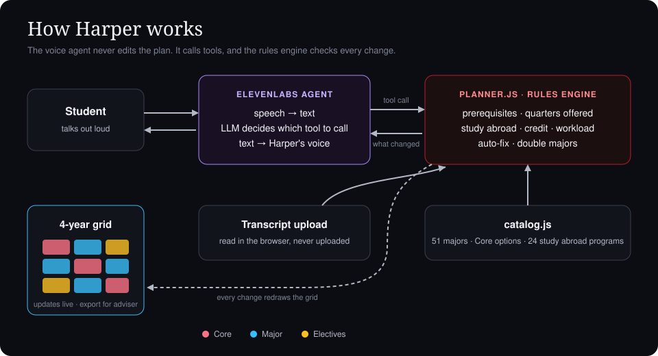

# Harper

Hi! Harper is an interactive tool that helps you talk to someone about your four-year graduation plan. I made this as part of my submission for the UChicago KTP Fall Voice AI Mini-Hack (Oct 17, 2026) with ElevenLabs.

Through this tool, you can talk to Harper about your four-year graduation plan. You speak with Harper and it helps you plan your time here in college. You tell Harper your major and it lays out a possible 12-quarter plan. Then you can talk to Harper about it, "I want to do Paris in the fall of third year," or "CMSC 14300 just filled up." The grid then automatically updates as you talk with Harper. Every quarter keeps at least 3 courses, as the university requires. If a course is incompatible with another course or isn't satisfied in your plan, it will turn red, and Harper will fix the plan on your behalf, taking into account your evolving preferences.

## Why

UChicago is a very unique university, with its CORE curriculum, complicated majors, and quarter system. Ensuring you have all the requirements to graduate is quite hard, as one change (a full class, a quarter abroad) can push something back a year without you noticing until it's too late. Plus, you only see your academic advisor on average no more than once a quarter, and they don't have as much time to help you plan as we would like. So, my tool, Harper can fill in this gap, acting as a personalized academic advisor available 24/7.

## How it works

- The voice side is powered by ElevenLabs. Harper doesn't edit the plan itself. Instead, it calls one of 19 tools (like `load_major`, `choose_core`, `set_study_abroad`, `mark_course_closed`, `add_second_major`, `auto_fix`, and `export_plan`). The full list is in `AGENT_SETUP.md`.
- `planner.js` does the actual checking (prereqs, which quarters a course is offered, study abroad rules, overloaded quarters) and tells Harper what changed.
- Harper then speaks the result out loud using text-to-speech.

We split it this way so the model can't make up a plan that breaks the rules. Whatever shows on screen has been checked.

## Files

- `index.html`: the page and the voice connection
- `styles.css`: styling
- `planner.js`: rules, auto-fix, and the tools
- `catalog.js`: course data, starting plans for 51 majors and tracks, Core options, and 24 study abroad programs
- `AGENT_SETUP.md`: prompt and tool settings for the ElevenLabs agent

## Running it

1. Set up the agent using `AGENT_SETUP.md`.
2. Put your agent ID in `index.html` where it says `AGENT_ID`.
3. Open `index.html` in Chrome and click "Talk to Harper."
    
You can also pick your own Core sequences ("switch my Sosc to Power, Identity, and Resistance," "do Civ in Rome"), and ask Harper to lighten a heavy year.

Already partway through? Click **Upload transcript** (PDF or text). Harper reads it in your browser (nothing is uploaded anywhere), locks the quarters you've finished, picks up your Core choices from what you took, and plans the rest. Try it with `sample-transcript.txt`.

Got AP or placement credit? Say "I have AP credit for Calc I and II" and those courses move to a Credit strip and count toward prerequisites.

Not sure which elective to take? Ask Harper for recommendations or how a course is. **The ratings are sample data generated for the demo, not real UChicago course evaluations.** The feature is built so real evaluation data could be plugged in later, with the university's permission.

You can add a second major ("add econ as a second major"). Courses both majors require are taken once and count for both (marked ×2 on the grid), including cross-listed courses that have different numbers in each department. Harper tells you if it doesn't fit in four years. Departments can limit double-counting, so check with your adviser.

Say "send this to my adviser" (or click Export for adviser) to get a one-page summary you can print or save as a PDF.

You can also try everything without voice using "Manual controls" on the right.

## About the data

The Core course numbers were checked against the College Catalog. Study abroad programs whose course numbers we couldn't verify show as "[City] Civ I/II" instead of a number.

The course data is a simplified sample based on the College Catalog. Some courses really have several ways to satisfy a prereq and we only list one, the quarters are usual offerings (not a guarantee for future years), and the hours per week are rough guesses. Don't use this to plan your actual schedule without checking with your adviser.

Adding a major just means adding its courses and a starting plan to `catalog.js`.

## The name

After William Rainey Harper, UChicago's first president, and the library on the quad.

## What we'd add next

- Minors, and rules for which courses can count for two programs
- Pulling course data straight from the catalog
- Real workload numbers from course evaluations
- Summer quarters

Independent student project, not affiliated with the University of Chicago.
